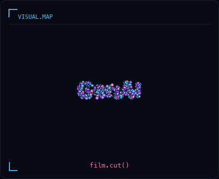

  

  

<!-- GENERATIVE VISUAL.MAP & LIVE STACK STREAM -->
<table>
  <tr>
    <td align="center" valign="top">
      
    </td>
    <td align="center" valign="top">
      
    </td>
  </tr>
</table>

  

<!-- FEATURED SYSTEMS (2 PRODUCTION PROJECTS) -->
<table>
  <tr>
    <td width="50%" align="center" valign="top">
      
       
      <a href="https://silent-galleryyy.vercel.app" target="_blank"><b>🚀 Launch Live Demo</b></a> &nbsp;|&nbsp; <a href="https://github.com/eng-yash007/silent_gallery" target="_blank"><b>💻 GitHub Repo</b></a>
    </td>
    <td width="50%" align="center" valign="top">
      
       
      <a href="https://guardian-transit-zeta.vercel.app" target="_blank"><b>🚀 Launch Live Demo</b></a> &nbsp;|&nbsp; <a href="https://github.com/eng-yash007/guardian-transit" target="_blank"><b>💻 GitHub Repo</b></a>
    </td>
  </tr>
</table>

  

  

<!-- VERIFIED SOCIAL PROFILES DOCK (SINGLE ROW, ZERO-WRAP, ZERO UNDERLINE GLITCH) -->
<table>
  <tr>
    <td align="center" valign="middle"></td>
    <td align="center" valign="middle"></td>
    <td align="center" valign="middle"></td>
    <td align="center" valign="middle"></td>
    <td align="center" valign="middle"></td>
  </tr>
</table>

  Automated via GitHub Actions • Data verified in real-time for <a href="https://github.com/eng-yash007" style="color: #2dd4bf; text-decoration: none;">eng-yash007</a>

