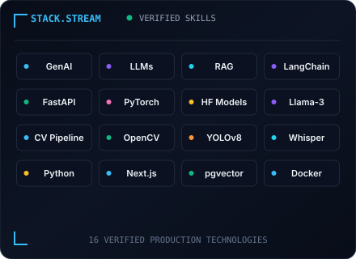
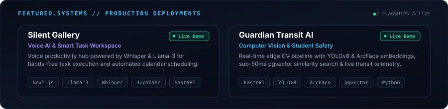
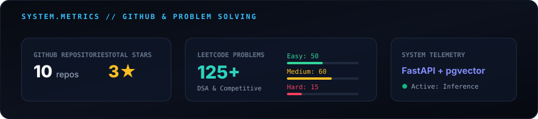
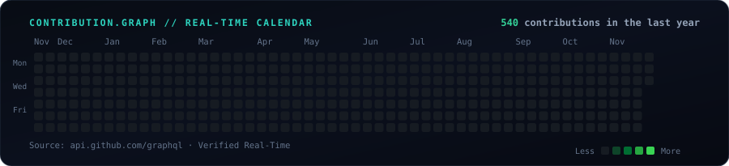

  

  

<table>
  <tr>
    <td align="center" valign="top">
      
    </td>
    <td align="center" valign="top">
      
    </td>
  </tr>
</table>

  

  

  

  

  
  &nbsp;
  
  &nbsp;
  
  &nbsp;
  
  &nbsp;
  

  Autonomous vector architecture &amp; dynamic profile telemetry • Built for <a href="https://github.com/eng-yash007" style="color: #2dd4bf; text-decoration: none;">eng-yash007</a>

