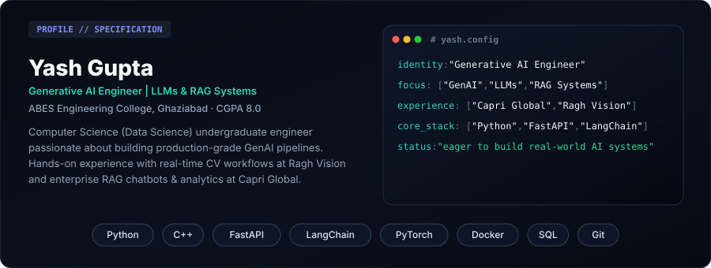
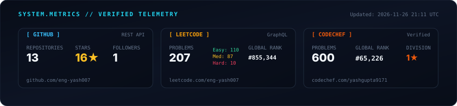

 

 

<!-- GENERATIVE VISUAL.MAP & LIVE STACK STREAM -->
<table>
  <tr>
    <td align="center" valign="middle">
      
    </td>
    <td align="center" valign="middle">
      
    </td>
  </tr>
</table>

<!-- FEATURED SYSTEMS (PREMIUM DARK TECH DEPLOYMENTS) -->

<table>
  <tr>
    <td width="440" align="center">
      <a href="https://silent-galleryyy.vercel.app" target="_blank">🚀 <b>Live Demo</b></a>
      &nbsp;&nbsp;&nbsp;&nbsp;•&nbsp;&nbsp;&nbsp;&nbsp;
      <a href="https://github.com/eng-yash007/silent_gallery" target="_blank">💻 <b>GitHub Repository</b></a>
    </td>
    <td width="440" align="center">
      <a href="https://guardian-transit-zeta.vercel.app" target="_blank">🚀 <b>Live Demo</b></a>
      &nbsp;&nbsp;&nbsp;&nbsp;•&nbsp;&nbsp;&nbsp;&nbsp;
      <a href="https://github.com/eng-yash007/guardian-transit" target="_blank">💻 <b>GitHub Repository</b></a>
    </td>
  </tr>
</table>

 

 

<!-- VERIFIED SOCIAL PROFILES DOCK (SINGLE ROW, ZERO-WRAP, ZERO UNDERLINE GLITCH) -->
<table>
  <tr>
    <td align="center" valign="middle"></td>
    <td align="center" valign="middle"></td>
    <td align="center" valign="middle"></td>
    <td align="center" valign="middle"></td>
    <td align="center" valign="middle"></td>
  </tr>
</table>

  Automated via GitHub Actions • Data verified in real-time for <a href="https://github.com/eng-yash007" style="color: #22D3EE; text-decoration: none;">eng-yash007</a>

